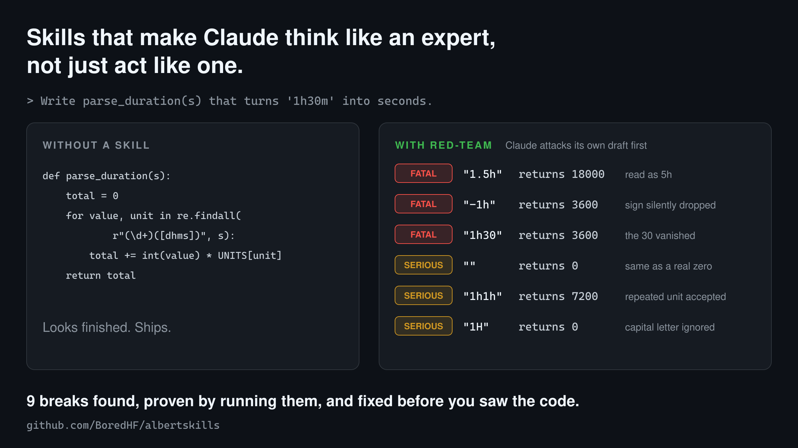

# albertskills

**Skills that make Claude think like an expert, not just act like one.**



Most skill packs are task recipes: how to plan, how to debug, how to review. The eleven thinking skills here are different. Each one changes *how* Claude thinks on any kind of work (code, writing, design, research, plans): it critiques itself, competes against itself, remembers its mistakes, and notices when it is stuck. The pack also carries the seven workflow skills I use to run bigger jobs.

## Before / after

The request: *"Write a Python function `parse_duration(s)` that turns strings like '1h30m' into seconds."*

**Without a skill**, Claude writes this. It looks finished.

```python
def parse_duration(s):
    """Turn a string like '1h30m' into seconds."""
    total = 0
    for value, unit in re.findall(r"(\d+)([dhms])", s):
        total += int(value) * UNITS[unit]
    return total
```

**With `red-team`**, Claude attacks its own draft before you see it, and runs every break:

```
RED TEAM: parse_duration(s) returns the exact number of seconds for strings like '1h30m'.
| # | Severity | Break                                               | Proof  | Fix                          |
|---|----------|-----------------------------------------------------|--------|------------------------------|
| 1 | Fatal    | "1.5h" returns 18000 (read as "5h")                 | ran it | decimals rejected            |
| 2 | Fatal    | "-1h" returns 3600, sign silently dropped           | ran it | rejected                     |
| 3 | Fatal    | "1h30" returns 3600, the 30 is dropped              | ran it | whole string must match      |
| 4 | Serious  | "" and "abc" return 0, same as a real zero          | ran it | ValueError                   |
| 5 | Serious  | "1h1h" returns 7200                                 | ran it | repeated unit rejected       |
| 6 | Serious  | "1H" returns 0                                      | ran it | units are case-insensitive   |
Re-attack: the fixes rejected "1h 30m5s" and raised KeyError on "1H". Both fixed.
Open: "1m1h" (out of order) is still accepted as 3660.
```

Nine breaks that would otherwise have shipped, three of them fatal, plus two bugs in the fixes themselves, caught on the second pass. That is real output from testing the skill, trimmed to six of its nine rows.

## Install

**Send this to your agent of choice:**

```
Install the albertskills skill pack for me. Clone https://github.com/BoredHF/albertskills into a temporary folder, copy every folder inside its skills/ directory into ~/.claude/skills/ (create it if it is missing), then delete the temporary folder. Finish by listing the skills you installed and showing me one example of how to use one.
```

Want it in one project only? Add: *"Install into .claude/skills/ in this project instead."*

**Or do it yourself.** For every project:

```bash
d=$(mktemp -d) && git clone --depth 1 https://github.com/BoredHF/albertskills "$d" && mkdir -p ~/.claude/skills && cp -r "$d"/skills/* ~/.claude/skills/ && rm -rf "$d"
```

For one project only, run this from the project root:

```bash
d=$(mktemp -d) && git clone --depth 1 https://github.com/BoredHF/albertskills "$d" && mkdir -p .claude/skills && cp -r "$d"/skills/* .claude/skills/ && rm -rf "$d"
```

To update, send the prompt or run the command again. Claude picks a skill up when your request matches its trigger. You can also just name it: *"red-team this"*, *"run a tournament on the headline"*.

## Thinking skills

| Skill | What it does | Triggers when |
|---|---|---|
| **tournament** | Writes 3–5 genuinely different versions, scores them blind against a rubric built for the task, merges the best parts. | The output matters and the first idea is rarely the best: "give me your best", "try a few approaches". |
| **red-team** | Becomes a hostile critic, breaks the work, ranks the breaks by severity, fixes them, then delivers. | Before anything gets shipped, sent or relied on: "poke holes in it", "be harsh". |
| **taste-thief** | Works out why an example you love is good, turns that into checkable rules, applies them to your work, saves them. | "Make it like this", "why is this so good", "match this style". |
| **failure-museum** | Keeps a project file of Claude's mistakes with the rule that prevents each one. Reads it before work, checks it before finishing. | You correct Claude, work gets redone, or "don't do that again". |
| **stuck-detector** | Spots loops (same fix three times, growing complexity, repeated failed commands), names the pattern, switches strategy. | A loop tripwire fires, or "you're going in circles". |
| **intent-diff** | Compares what you asked for with what was delivered, point by point. Fixes misses, flags drift, reverts extras. | The end of any multi-part task: "did you do everything?" |
| **confidence-map** | Labels each key claim verified, inferred or guessed, and lists what to double-check first. | Research, analysis, debugging conclusions: "how sure are you?" |
| **ghost-users** | Walks 3–5 realistic personas through your product, doc or flow and reports where each gets stuck, confused or leaves. | Before people use it without you there: "where will people get stuck?" |
| **expert-ask** | Rewrites a rough request into the brief a world-class expert would ask for, then delivers against it. | A short request where quality depends on unstated standards: "do it properly". |
| **premortem** | Assumes the work has already failed, lists why, and builds the top risks into the plan as checks. | Before significant, expensive or irreversible work: "what could go wrong?" |
| **autopsy** | Reviews a finished session: what worked, what wasted time, what to change. Saves the lessons. | The end of a long session or project: "what did we learn?" |

Every skill says when *not* to run, and most have a lighter version, so none of them burns tokens on trivial work.

## Workflow skills

| Skill | What it does | Triggers when | Needs |
|---|---|---|---|
| **autopilot** | Hands-off mode. One round of questions, a mission plan, then Claude keeps prompting itself step by step until the mission is done and reports back. | "autopilot", "keep going without me", "do it yourself and get back to me". | Hooks, added on first run with your OK. |
| **delegate** | Splits a job into tasks with a check you can run, routes each to the cheapest model that can do it, runs them in parallel waves, verifies every result. | "delegate this", "use subagents", "do these in parallel". | Nothing. |
| **grill-dump** | Turns large, messy brain dumps into a source-grounded connection map and a confirmed plan. | Ideas scattered across long notes or files: "make sense of everything I dumped". | Nothing. |
| **mind-map** | Turns a brain dump into a branching mind map through rounds of questions, saved as an HTML map you can reopen and resume. | "mind map this", "let me brain dump", "help me break this idea down". | Node.js. |
| **md-to-map** | Converts existing Markdown notes into mind maps by script, so the notes never get read into context. | "turn these notes into a mind map", "map out this file". | `mind-map`. |
| **work** | Turns a mind-map plan into task cards with a small v1 finish line, splits the work between you and Claude, and tracks progress. | "let's work on this", "what's next", "I'm stuck". | `mind-map`. |
| **shipit** | Feature delivery from end to end: grill the requirements, specify, plan, tasks, implement, review, then optionally PR and release. | "ship it", or a feature you want taken all the way. | Spec Kit. |

## How they combine

```
expert-ask → premortem → the work → red-team → intent-diff → autopsy → failure-museum
                            │                                              │
                     stuck-detector                          read at the start of the next task
```

- **Before:** `expert-ask` raises the brief, `premortem` puts tripwires in the plan.
- **During:** `tournament` picks the approach, `taste-thief` sets the standard, `stuck-detector` breaks loops.
- **Before handing over:** `red-team` breaks it, `ghost-users` walks through it, `intent-diff` checks it against what you asked, `confidence-map` tells you what to verify.
- **After:** `autopsy` extracts the lessons and `failure-museum` keeps them, so the next session starts smarter than this one did.

To make the museum load on its own, add one line to your project's `CLAUDE.md`:

```
Read `.claude/failure-museum.md` before starting work and run its matching checks before finishing (skill: failure-museum).
```

## License

MIT
